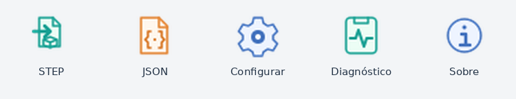

# Barra de ferramentas — 0.4.0

A ilustração mostra os recursos fornecidos pelo projeto, não uma captura real do SketchUp.

## Abrir e posicionar

Após instalar o RBZ e reiniciar o SketchUp, a barra FreeCAD Bridge é exibida quando ainda não foi utilizada. Arraste-a para uma borda da janela para encaixar ou deixe-a flutuante. A API nativa restaura posição e visibilidade nas sessões seguintes.

Se estiver oculta, use **Extensões → FreeCAD Bridge → Mostrar barra de ferramentas**. No Windows, ela também pode ser habilitada na lista de barras de ferramentas do SketchUp. Trata-se de uma barra nativa de comandos; não é um painel da bandeja lateral padrão.

## Atalhos

| Ícone | Comando | Resultado |
| --- | --- | --- |
| Documento e seta verde | STEP | Abre o seletor STEP, solicita qualidade/modo e executa FreeCADCmd. |
| Documento com chaves laranja | JSON | Abre um arquivo `yk-step-bridge-1` já convertido. |
| Engrenagem azul | Configurar | Seleciona e salva o caminho de FreeCADCmd.exe. |
| Prancheta verde | Diagnóstico | Exibe versão, caminho do executável, existência e localização da configuração. |
| Informação azul | Sobre | Exibe autoria, versão e licença. |

Passe o mouse para ver a dica. Durante uma conversão externa, STEP e JSON ficam desabilitados. Aguarde a conclusão antes de iniciar outra importação. Os mesmos comandos continuam disponíveis no menu Extensões.

## Atualização

A versão 0.4.0 preserva o carregador e as configurações existentes. Reinicie o SketchUp após instalar; instalar sobre arquivos antigos não substitui o Ruby já carregado naquela sessão.

Confira **Diagnóstico (0.4.1)**. Se aparecer versão antiga, verifique duplicatas do carregador na pasta Plugins ou instalação de um RBZ anterior.

## Implementação e limites

`UI::Command` compartilha callbacks entre menu e barra. Os ícones PNG de 24 e 32 pixels são carregados de `yk_step_bridge/icons/`; os SVGs originais também são distribuídos para manutenção. A inicialização usa `get_last_state`, `show` e `restore` da API nativa.

O empacotamento confere a presença dos dez PNGs e cinco SVGs. Não há nova dependência em tempo de execução. A interface real e a persistência de posição precisam ser verificadas no SketchUp; a checagem local não simula a janela do aplicativo.
